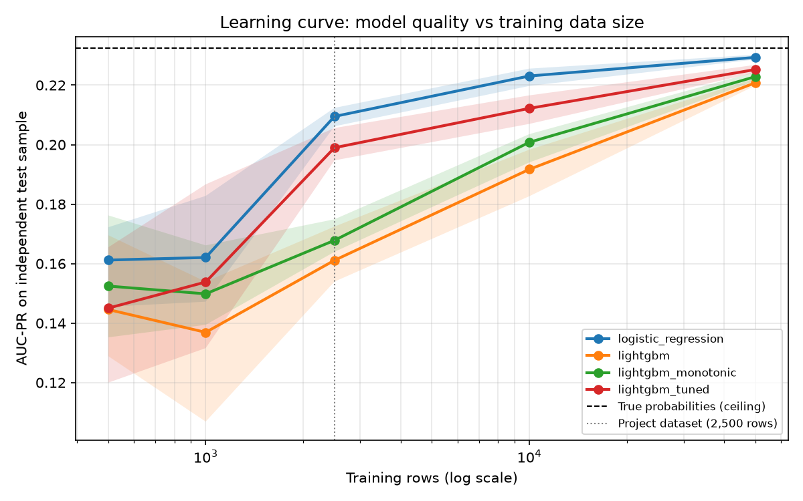
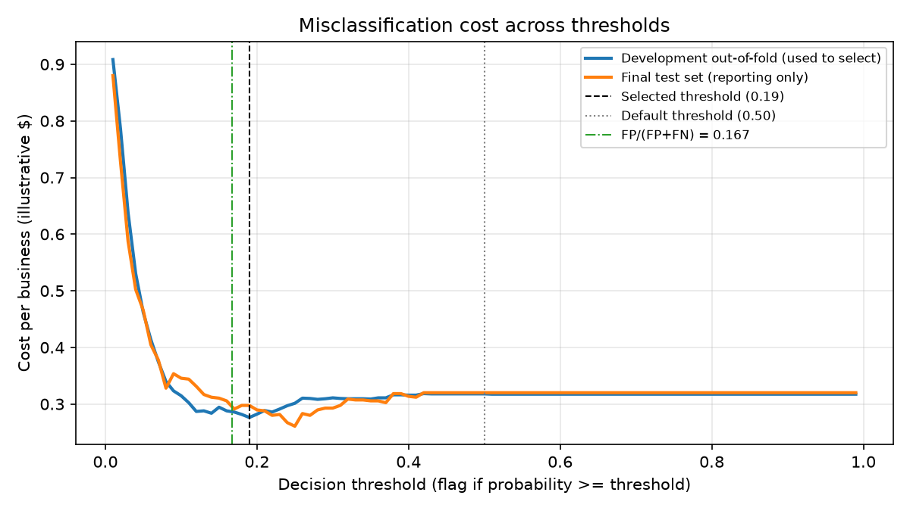
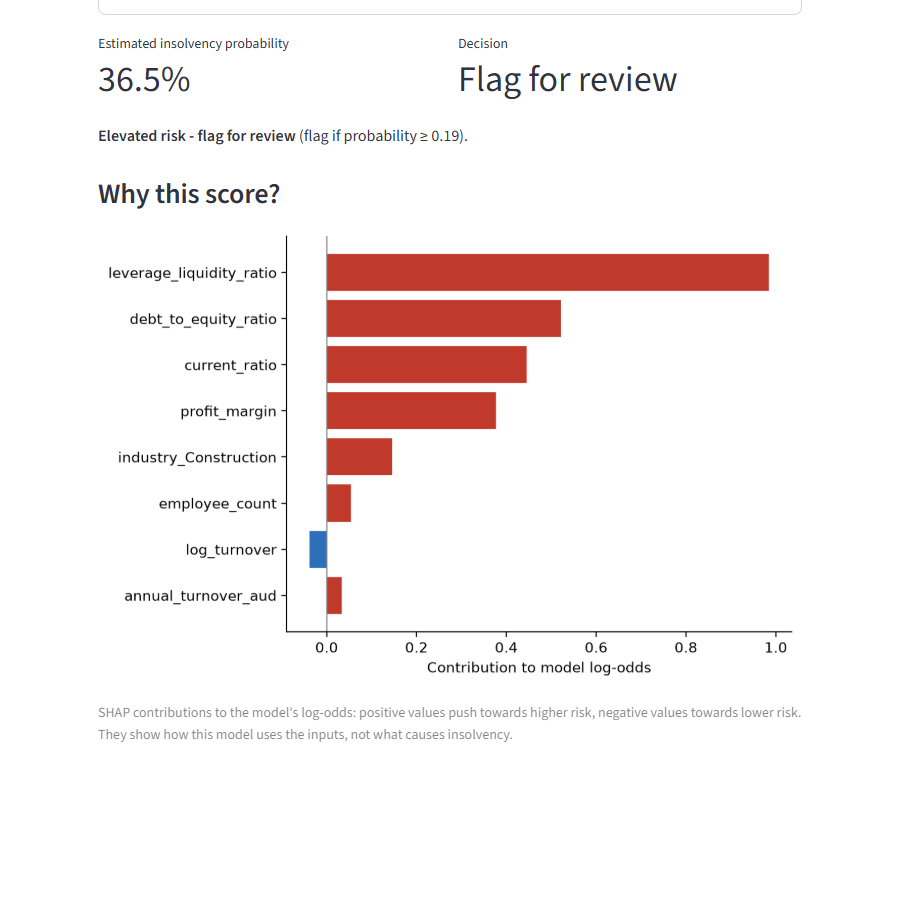

# Enterprise Default Radar

A reproducible machine learning pipeline that estimates business insolvency risk from structured financial data. It compares gradient-boosting models on identical cross-validation splits, calibrates probabilities, chooses a decision threshold from explicit misclassification costs, explains predictions with SHAP, reports subgroup performance and monitors data drift. A small Streamlit app scores a single business.

> **Synthetic data.** The dataset is generated, not collected. Its distributions are loosely shaped after public economic statistics, and the target is drawn from a known logistic model. Results show the methodology working; they say nothing about performance on real businesses.

## Results

All figures come from `uv run python scripts/run_pipeline.py` (seed 42). The final test set (625 businesses, 40 insolvent) was used once, after the model, calibration and threshold had been chosen. Brackets are 95% bootstrap intervals.

**Model tournament** (5-fold stratified CV x 3 repeats on the 1,875-row development set; every model uses the same splits, and tuning is nested inside each training fold; AUC-PR is the primary metric):

| Model | Monotonic | Tuned | CV AUC-PR (mean +/- sd) | Folds beating baseline |
| --- | --- | --- | --- | --- |
| **LightGBM, monotonic + tuned (selected)** | yes | yes | **0.243 +/- 0.068** | 12/15 |
| XGBoost, monotonic + tuned | yes | yes | 0.240 +/- 0.089 | 12/15 |
| XGBoost, monotonic | yes | no | 0.225 | |
| LightGBM, monotonic | yes | no | 0.224 | |
| LightGBM, defaults | no | no | 0.197 +/- 0.053 | 8/15 |
| HistGradientBoosting (original baseline) | no | no | 0.193 +/- 0.067 | |
| XGBoost, defaults | no | no | 0.190 +/- 0.048 | 8/15 |
| CatBoost, defaults | no | no | 0.172 +/- 0.039 | 7/15 |
| Logistic regression (reference only) | | | 0.288 +/- 0.093 | 14/15 |
| True generating probabilities (ceiling) | | | 0.298 +/- 0.111 | |

**Held-out test set:**

| Model | AUC-PR | ROC-AUC | Brier |
| --- | --- | --- | --- |
| Selected: LightGBM monotonic + tuned, sigmoid-calibrated | 0.219 [0.126, 0.366] | 0.736 [0.645, 0.821] | 0.057 [0.043, 0.072] |
| HistGradientBoosting baseline (uncalibrated) | 0.224 [0.125, 0.380] | 0.727 [0.647, 0.810] | 0.121 [0.106, 0.135] |
| True generating probabilities (ceiling) | 0.235 [0.135, 0.386] | 0.754 [0.679, 0.829] | 0.055 [0.041, 0.071] |

What the numbers say:

- **Domain constraints and tuning help the boosters.** Telling the model that risk can only rise with leverage and only fall with liquidity, margin and firm age lifts CV AUC-PR from about 0.19 to 0.22. Nested Optuna tuning lifts it to 0.24, and the tuned model beats the defaults in 13 of 15 folds. That closes about half the gap to the ceiling.
- **A linear model is still best on this data, and the learning curve shows why.** The generator is a logistic model, so logistic regression is correctly specified. Training on fresh samples of 500 to 50,000 businesses ([results/learning_curve.md](results/learning_curve.md)) shows the tuned booster trailing by about 0.01 AUC-PR up to 10,000 rows and by 0.004 at 50,000, as both approach the ceiling. Boosting needs more data to rebuild smooth relationships from splits. Logistic regression was declared a reference before any run, so it was not eligible for selection.
- **The test set cannot separate the models.** With 40 test insolvencies, the AUC-PR difference between the selected model and the baseline is -0.005 [-0.073, 0.049]. Cross-validation over 1,875 businesses is the more reliable comparison.
- **Calibration matters.** Sigmoid calibration lowers the test Brier score from 0.166 to 0.057, close to the ceiling's 0.055.
- **The cost-based threshold matches theory.** With a $1 false-positive and $5 false-negative cost, the threshold chosen on out-of-fold predictions is 0.19, near the theoretical 1/6 = 0.167 for calibrated probabilities. On the test set it costs $186 against $196 for the original uncalibrated 0.50 rule. That $10 saving has an interval of $-17 to $37, which includes zero.
- **Explanations expose remaining noise-fitting.** 30% of SHAP attribution still goes to inputs that have no real effect in the generator.
- **Drift checks behave as intended.** The test set shows no drift (max PSI 0.034). A simulated downturn raises critical alerts and doubles the flag rate, and a simulated data-quality issue flags the missing column and the malformed values.

The original handover reported a $37 (18.5%) saving at a 0.80 threshold. That threshold had been tuned on the test labels; see [docs/baseline_verification.md](docs/baseline_verification.md).

## Reports

| File | Contents |
| --- | --- |
| [results/model_comparison.md](results/model_comparison.md) | Tournament summary, constraint/tuning ablation and final test comparison |
| [results/model_tournament.csv](results/model_tournament.csv) | Fold-level metrics with runtime, versions, the hyperparameters used in each fold and the seed |
| [results/tuning_trials.csv](results/tuning_trials.csv) | Every Optuna trial in every outer fold; `final_model_tuning_trials.csv` covers the final refit |
| [results/learning_curve.md](results/learning_curve.md) | Model quality against training-set size (500 to 50,000 rows) |
| [results/threshold_report.md](results/threshold_report.md) | Cost assumptions, confusion matrices and cost savings with intervals |
| [results/calibration_report.md](results/calibration_report.md) | Calibration method selection and test Brier / log loss |
| [results/subgroup_report.md](results/subgroup_report.md) | Performance by state and industry with group and positive counts |
| [results/drift_report.md](results/drift_report.md) | PSI / KS results for stable, shifted and malformed batches |
| [results/example_explanations.md](results/example_explanations.md) | SHAP explanations for individual businesses and the generator sanity check |
| [results/run_metadata.json](results/run_metadata.json) | Configuration, data hash, library versions, final hyperparameters and metrics |
| [docs/model_card.md](docs/model_card.md) | Intended use, evaluation, limitations and ethical considerations |
| [docs/baseline_verification.md](docs/baseline_verification.md) | Reproduction of the original baseline, issues found and fixes |
| [docs/data_dictionary.md](docs/data_dictionary.md) | Columns, target definition and validation rules |

<p>
  
  
</p>

## Project structure

```text
Enterprise-Default-Radar/
├── .github/workflows/ci.yml        # Lint, tests, end-to-end smoke run and batch scoring on every push
├── app/
│   └── streamlit_app.py            # Interactive single-business scoring with SHAP explanation
├── configs/                        # One YAML file per model in the tournament
│   ├── hist_gradient_boosting.yaml # Original baseline
│   ├── xgboost.yaml                # Library defaults
│   ├── xgboost_monotonic.yaml      # + monotonic constraints
│   ├── xgboost_tuned.yaml          # + nested Optuna tuning
│   ├── lightgbm.yaml
│   ├── lightgbm_monotonic.yaml
│   ├── lightgbm_tuned.yaml         # Selected model
│   ├── catboost.yaml
│   └── logistic_regression.yaml    # Reference only (not selectable)
├── data/
│   ├── raw/business_outcomes.csv   # 2,500 synthetic businesses used for training and testing
│   └── sample/businesses_sample.csv # Example input for batch scoring (includes two invalid rows)
├── docs/
│   ├── baseline_verification.md    # Reproduction of the original baseline, issues found and fixes
│   ├── data_dictionary.md          # Columns, target definition and validation rules
│   ├── model_card.md               # Intended use, evaluation, limitations and ethics
│   └── images/                     # App screenshots
├── models/                         # Trained model artifact (created by run_pipeline.py, not committed)
├── results/                        # Reports and figures generated by the scripts
│   ├── model_comparison.md         # Tournament, ablation and final test comparison
│   ├── model_tournament.csv        # Fold-level metrics, hyperparameters and versions
│   ├── tuning_trials.csv           # Every Optuna trial in every outer fold
│   ├── threshold_report.md         # Cost-based threshold and confusion matrices
│   ├── calibration_report.md       # Calibration selection and reliability diagram
│   ├── subgroup_report.md          # Performance by state and industry
│   ├── drift_report.md             # PSI / KS checks on stable, shifted and malformed data
│   ├── example_explanations.md     # SHAP explanations for individual businesses
│   ├── learning_curve.md           # Model quality vs training-set size
│   ├── run_metadata.json           # Config, data hash, versions and final metrics
│   ├── *.png / *.csv               # Figures and tables referenced by the reports
│   └── baseline/original_report.md # Archived output of the original pipeline
├── scripts/
│   ├── run_pipeline.py             # End-to-end training, evaluation and reporting
│   ├── run_learning_curve.py       # Learning-curve experiment
│   ├── score_csv.py                # Batch scoring of a CSV file
│   └── generate_synthetic_business_data.py  # Recreates data/raw/business_outcomes.csv
├── src/                            # Library code (see the module table below)
├── tests/                          # 125 pytest tests and the fast CI config (ci_config.yaml)
├── config.yaml                     # Seeds, CV design, costs, thresholds, drift and learning-curve settings
├── pyproject.toml                  # Package metadata, dependency groups, pytest and ruff settings
├── uv.lock                         # Exact dependency versions
├── requirements.txt                # pip alternative to uv
└── LICENSE                         # MIT
```

## How it works

```
data/raw/business_outcomes.csv
        |  validate schema, stratified 75/25 split
        v
development set (1,875) ------------------------------------------+
        |  repeated stratified 5-fold CV, identical splits        |
        |  per fold: [Optuna search on that fold only] ->         |
        |  outlier caps -> features -> (monotonic) model          |
        v                                                         |
out-of-fold predictions -> pick model (AUC-PR)                    |
                        -> pick calibration (CV Brier)            |
                        -> pick threshold (min cost)              |
        |                                                         |
        v                                                         |
refit selected pipeline on all development data <-----------------+
        |
        v
final test set (625): scored once -> metrics, cost, calibration, subgroups, drift, SHAP
        |
        v
models/risk_model.joblib -> Streamlit app
```

| Module | Purpose |
| --- | --- |
| `src/ingest.py` | Load the CSV and validate columns, types, missing values, target labels and IDs |
| `src/preprocess.py` | Stratified split; `OutlierCapper` learns percentile caps on training data only |
| `src/feature_engineering.py` | Financial ratios and one-hot encoding with categories fixed at fit time |
| `src/train.py` | Builds a leakage-free scikit-learn `Pipeline` for each model type and maps monotonic constraints to each library |
| `src/tuning.py` | Optuna search spaces and `fit_model`, which tunes (if configured) and fits on the data it is given |
| `src/tournament.py` | Parallel repeated stratified CV tournament with nested tuning, out-of-fold predictions and fold-level records |
| `src/learning_curve.py` | Model quality against training-set size on fresh synthetic samples |
| `src/calibrate.py` | Platt / isotonic calibration chosen by cross-validated Brier score |
| `src/threshold.py` | Cost curves and cost-minimising threshold selection |
| `src/evaluate.py` | Metrics and percentile bootstrap confidence intervals |
| `src/fairness.py` | Per-group rates, minimum-size rules and disparity summaries |
| `src/drift.py` | Numeric and categorical PSI, KS test, missing and malformed value checks |
| `src/interpret.py` | SHAP global and local explanations, with a permutation-importance fallback |
| `src/pipeline.py` | `RiskModel`: pipeline + calibrator + threshold, used for scoring |
| `src/schema.py` | Column definitions and the validated `BusinessProfile` input model |
| `src/batch.py` | Validates and scores many records; invalid rows are explained, not dropped |
| `app/streamlit_app.py` | Interactive single-business scoring with a local explanation |

## Quick start

Requires [uv](https://docs.astral.sh/uv/). The project pins Python 3.12 (`.python-version`) and keeps all dependencies in its own `.venv`.

```bash
cd "Enterprise Default Radar"
uv sync --all-extras                      # core + boosters, SHAP, Streamlit and test tools

uv run python scripts/run_pipeline.py     # about 2 minutes on a multi-core machine; writes results/ and models/
uv run pytest tests                       # 125 tests
uv run ruff check .                       # lint
uv run streamlit run app/streamlit_app.py # demo app at http://localhost:8501
```

Optional steps:

```bash
uv run python scripts/generate_synthetic_business_data.py   # regenerate the dataset (identical output)
uv run python scripts/run_pipeline.py --config my_config.yaml --output-dir runs/experiment1
uv run python scripts/run_learning_curve.py                 # learning-curve experiment, about 3 minutes
uv run python scripts/score_csv.py data/sample/businesses_sample.csv   # batch scoring -> *_scored.csv
```

`data/sample/businesses_sample.csv` holds 20 synthetic businesses plus two deliberately invalid rows. To score your own file, give it the same columns. `score_csv.py` keeps every input column and adds `insolvency_probability`, `flagged`, `risk_category`, `warnings` (values outside the training range) and `validation_error` (rows that could not be scored, with the reason).

GitHub Actions (`.github/workflows/ci.yml`) installs from the lockfile, then runs lint, the tests with coverage, and a fast end-to-end smoke run (`tests/ci_config.yaml`) followed by batch scoring.

Dependency groups: `advanced` (XGBoost, LightGBM, CatBoost, SHAP, Optuna), `app` (Streamlit), `dev` (pytest, ruff). With only the core dependencies, the tournament skips models whose libraries are missing and explainability falls back to permutation importance. `requirements.txt` lists the same packages for pip users.

## Configuration

- `config.yaml`: seed, split size, CV design and parallelism, cost assumptions, threshold grid, calibration methods, bootstrap rounds, subgroup minimum sizes, drift thresholds and learning-curve settings.
- `configs/*.yaml`: one file per model with its role (`baseline`, `candidate` or `reference`), hyperparameters, optional `monotonic_constraints` (feature: +1/-1) and optional `tuning` (Optuna trials and inner folds). Add a file and list it under `tournament.model_configs` to enter a new model. A constraint on a raw input must be matched by its derived ratio (enforced at build time).

The costs (`$1` per unnecessary review, `$5` per missed insolvency) are illustrative assumptions. Change them and rerun to see the threshold move.

## Demo app



The app validates every input (known categories, positive ratios, R&D not above turnover, and so on), shows the calibrated probability, the threshold decision and the main contributions to the score. It warns when a value lies outside the training range. It does not store anything that is entered.

## Limitations

- **Synthetic data only.** Relationships, group differences and accuracy are properties of the generator. They do not describe real Australian businesses.
- **Small number of positives.** 119 insolvencies for training and 40 for testing give wide confidence intervals; most differences between models are within noise.
- **Illustrative costs.** Real review costs, capacity limits and losses from missed insolvencies are not modelled.
- **Subgroups.** Several states and industries have fewer than five insolvencies in the test set. Their rates are listed but not compared, and no fairness conclusion should be drawn from them.
- **Explanations are not causes.** SHAP shows how the model uses its inputs, including inputs it should ignore.
- **Drift alerts** are prompts to investigate the data, not proof that accuracy has dropped.

## License

MIT. See [LICENSE](LICENSE).
