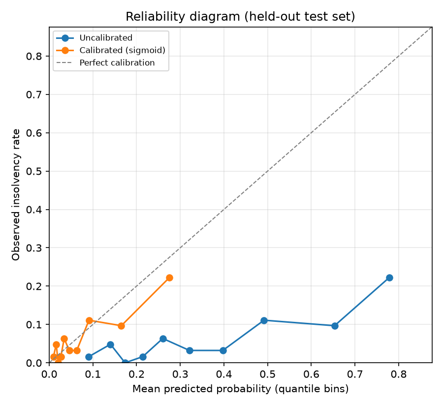

# Probability calibration report

> **Synthetic data.** All results come from a synthetic dataset whose target was drawn from a known logistic model. They demonstrate the methodology only and say nothing about performance on real businesses.

The selected model (`lightgbm_tuned`) is trained with balanced class weights, so its raw scores are not probabilities. On the development set its out-of-fold scores average 0.341 against an observed insolvency rate of 0.063, but the averages hide how the scores are spread: the reliability diagram below shows whether high scores are over- or under-confident. Calibration maps scores to probabilities that can be read as risk estimates and compared with the cost-based threshold.

## Method selection (development set, cross-validated)

Each method was fitted and scored with 5-fold CV on the out-of-fold predictions of the development set. Lowest Brier score wins.

| method | brier_score | log_loss | mean_predicted | observed_rate |
| --- | --- | --- | --- | --- |
| sigmoid | 0.0557 | 0.2138 | 0.0636 | 0.0635 |
| isotonic | 0.0565 | 0.2263 | 0.0640 | 0.0635 |
| none | 0.1489 | 0.4673 | 0.3414 | 0.0635 |

**Selected:** `sigmoid`.

## Held-out test set (reporting only)

| predictions | brier_score | log_loss | mean_predicted | observed_rate |
| --- | --- | --- | --- | --- |
| Uncalibrated | 0.1662 | 0.5037 | 0.3521 | 0.0640 |
| Calibrated (sigmoid) | 0.0565 | 0.2163 | 0.0749 | 0.0640 |

## Limitations

- With few test positives, each reliability bin holds only a handful of insolvencies, so the curve is noisy.
- The calibrator is fitted on out-of-fold scores, while the deployed model is refitted on all development data; its score distribution can differ slightly.
- Calibration changes probability values, not the ranking, so AUC-PR and ROC-AUC are unaffected.
