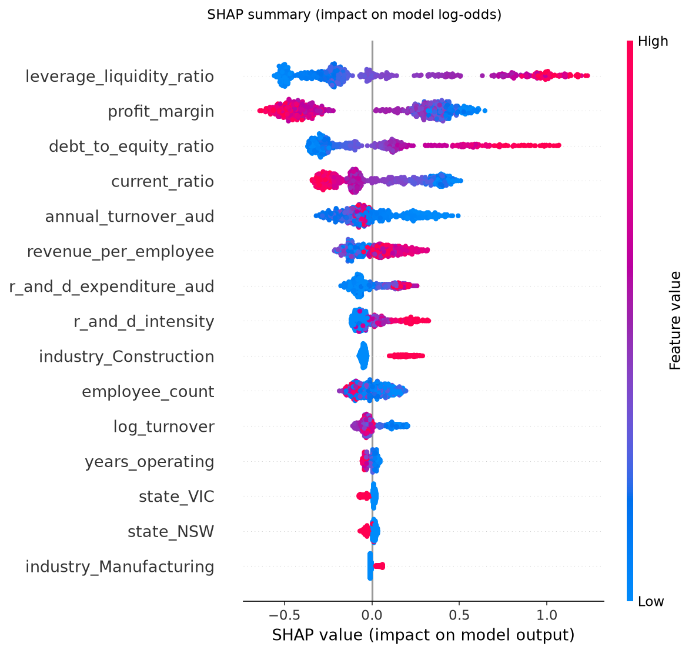

# Example prediction explanations

> **Synthetic data.** All results come from a synthetic dataset whose target was drawn from a known logistic model. They demonstrate the methodology only and say nothing about performance on real businesses.

SHAP values (tree explainer) for three test businesses, top six contributions each. Positive values push the uncalibrated model's log-odds towards insolvency. They describe how the model uses its inputs and do not establish causes of insolvency.

## Global importance by input column (mean |SHAP|, one-hot columns summed)

| source_column | mean_abs_shap |
| --- | --- |
| leverage_liquidity_ratio | 0.4251 |
| profit_margin | 0.3948 |
| debt_to_equity_ratio | 0.2912 |
| current_ratio | 0.2268 |
| annual_turnover_aud | 0.1437 |
| revenue_per_employee | 0.1087 |
| industry | 0.1022 |
| r_and_d_expenditure_aud | 0.0946 |
| r_and_d_intensity | 0.0808 |
| employee_count | 0.0748 |
| state | 0.0571 |
| log_turnover | 0.0552 |
| years_operating | 0.0221 |

**Sanity check against the known generator.** 30% of total attribution goes to inputs that have no effect on the synthetic target (state, employee count, turnover, R&D spend and ratios built only from them). A model that had learned only the true signal would put close to 0% there; a large share means the model is partly fitting noise in a small training set (119 insolvencies), which is consistent with the linear reference model outperforming the boosters in `model_comparison.md`. The true drivers are leverage, liquidity, profit margin, years operating and industry.

## Highest predicted risk

Calibrated probability 0.414 (threshold 0.19); actual outcome: insolvent. Model base value -0.755 log-odds.

Inputs: state=WA, industry=Accommodation & Food, employee_count=7, annual_turnover_aud=852090.77, years_operating=17, r_and_d_expenditure_aud=75182.34, debt_to_equity_ratio=6.0, current_ratio=0.703, profit_margin=-0.0249

| feature | feature_value | shap_value |
| --- | --- | --- |
| leverage_liquidity_ratio | 6.682 | 1.011 |
| debt_to_equity_ratio | 5.032 | 0.879 |
| current_ratio | 0.703 | 0.345 |
| profit_margin | -0.025 | 0.295 |
| annual_turnover_aud | 852090.770 | 0.107 |
| r_and_d_intensity | 0.088 | 0.106 |

## Closest to the decision threshold

Calibrated probability 0.192 (threshold 0.19); actual outcome: not insolvent. Model base value -0.755 log-odds.

Inputs: state=NSW, industry=Mining, employee_count=37, annual_turnover_aud=4983491.71, years_operating=17, r_and_d_expenditure_aud=0.0, debt_to_equity_ratio=5.56, current_ratio=1.151, profit_margin=0.2067

| feature | feature_value | shap_value |
| --- | --- | --- |
| leverage_liquidity_ratio | 4.189 | 1.221 |
| debt_to_equity_ratio | 5.032 | 1.015 |
| profit_margin | 0.207 | -0.338 |
| current_ratio | 1.151 | 0.233 |
| employee_count | 37.000 | -0.104 |
| annual_turnover_aud | 4983491.710 | -0.093 |

## Lowest predicted risk

Calibrated probability 0.005 (threshold 0.19); actual outcome: not insolvent. Model base value -0.755 log-odds.

Inputs: state=VIC, industry=Professional Services, employee_count=11, annual_turnover_aud=1967193.58, years_operating=13, r_and_d_expenditure_aud=0.0, debt_to_equity_ratio=0.536, current_ratio=2.082, profit_margin=0.1975

| feature | feature_value | shap_value |
| --- | --- | --- |
| leverage_liquidity_ratio | 0.251 | -0.515 |
| profit_margin | 0.198 | -0.474 |
| debt_to_equity_ratio | 0.536 | -0.332 |
| annual_turnover_aud | 1967193.580 | -0.295 |
| current_ratio | 2.082 | -0.277 |
| revenue_per_employee | 178835.780 | 0.228 |
